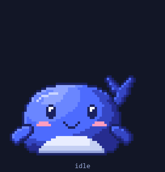
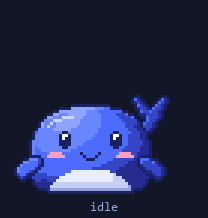
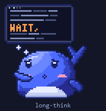
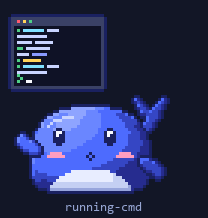
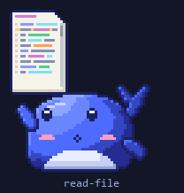
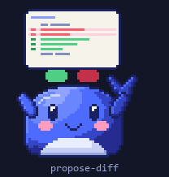
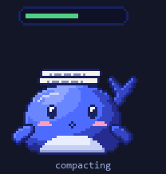
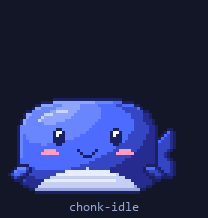
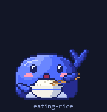
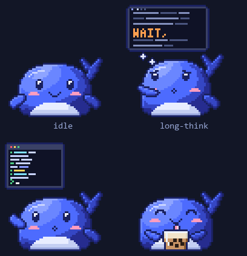

# opencode-大肥鱼

A pixel whale that sits on your desktop and reacts to what your coding agent is
actually doing — thinking, reading files, running commands, proposing diffs,
compacting, waiting on you.

Not a timer that guesses. It reads your agent's local session database,
read-only, and maps real events to real frames.

[](https://github.com/49vxn/opencode-dafeiyu/releases/latest)
[](https://github.com/49vxn/opencode-dafeiyu/releases/latest)
[](LICENSE.md)
[](LICENSE.md)

<p align="center">
  
</p>

**Just want to run it?** [Download the installer](https://github.com/49vxn/opencode-dafeiyu/releases/latest/download/dafeiyu-Setup-0.4.4.exe) —
Windows 10/11, one click, no Node, no terminal. The whale lands in the corner and
starts reacting the moment you open your agent.


---

## What it actually looks like

| | state | when you see it |
|---|---|---|
|  | `idle` | nothing running |
|  | `long-think` | the reasoning trace is streaming |
|  | `running-cmd` | a shell command is executing |
|  | `read-file` | it's reading source |
|  | `propose-diff` | an edit is being staged |
|  | `compacting` | context is being compacted |
|  | `sleeping` | idle for a while |
|  | `boba` | it drifts off between turns |
|  | `chonk-idle` | it has eaten a lot of rice |
|  | `eating-rice` | you clicked it |

<p align="center">
  
</p>

---

## Why this exists

Checking whether your agent finished means alt-tabbing out of what you're doing.
So the agent gets a face instead: one whale per live session, a nametag over each
one, and a state you can read from three metres away.

- **89 animation states** — 55 base plus 34 chonk variants, 64×64 pixel art, transparent overlay
- **Up to three sessions** shown side by side, each with its own nametag
- **Click a whale** and it eats a bowl of rice
- **Click-through by default** — it never eats your clicks, only when you hover it
- **No network, no telemetry, no account.** Nothing leaves the machine

## Sources

It ships three adapters and picks automatically:

| adapter | reads | notes |
|---|---|---|
| **opencode** | `~/.local/share/opencode/opencode.db` | preferred when a turn is running |
| **freebuff** | `~/.config/freebuff-desktop/projects/*/desktop-v2.db` | fallback source |
| **claude** | `~/.claude/projects/*/*.jsonl` | zero config; hooks make it instant |

All three read their source **read-only** and never write to it. A source only counts
as live if its state file updated in the last 15 seconds, so a file left behind by
a crash can't keep the whale pretending to work.

Whichever source has a turn in flight wins; another takes over only when it is
busy and the first is not.

### Claude Code

The claude adapter spawns only when `~/.claude` exists, so it costs nothing if
you don't use Claude Code. It works with **zero config**: it tails the session
transcripts under `~/.claude/projects/` — a tool call with no result yet is
running, ~45s of silence on one is a permission prompt, then the usual idle
ladder.

For instant and more precise states, let Claude Code push its own events. Add
this to `~/.claude/settings.json` (merge it with any hooks you already have;
all eleven use the same one-liner):

```json
{
  "hooks": {
    "UserPromptSubmit":   [{ "hooks": [{ "type": "command", "command": "curl -s -o NUL -X POST --data-binary @- http://127.0.0.1:8793/event" }] }],
    "PreToolUse":         [{ "hooks": [{ "type": "command", "command": "curl -s -o NUL -X POST --data-binary @- http://127.0.0.1:8793/event" }] }],
    "PostToolUse":        [{ "hooks": [{ "type": "command", "command": "curl -s -o NUL -X POST --data-binary @- http://127.0.0.1:8793/event" }] }],
    "PostToolUseFailure": [{ "hooks": [{ "type": "command", "command": "curl -s -o NUL -X POST --data-binary @- http://127.0.0.1:8793/event" }] }],
    "Notification":       [{ "hooks": [{ "type": "command", "command": "curl -s -o NUL -X POST --data-binary @- http://127.0.0.1:8793/event" }] }],
    "Stop":               [{ "hooks": [{ "type": "command", "command": "curl -s -o NUL -X POST --data-binary @- http://127.0.0.1:8793/event" }] }],
    "StopFailure":        [{ "hooks": [{ "type": "command", "command": "curl -s -o NUL -X POST --data-binary @- http://127.0.0.1:8793/event" }] }],
    "SubagentStart":      [{ "hooks": [{ "type": "command", "command": "curl -s -o NUL -X POST --data-binary @- http://127.0.0.1:8793/event" }] }],
    "SubagentStop":       [{ "hooks": [{ "type": "command", "command": "curl -s -o NUL -X POST --data-binary @- http://127.0.0.1:8793/event" }] }],
    "PreCompact":         [{ "hooks": [{ "type": "command", "command": "curl -s -o NUL -X POST --data-binary @- http://127.0.0.1:8793/event" }] }],
    "PostCompact":        [{ "hooks": [{ "type": "command", "command": "curl -s -o NUL -X POST --data-binary @- http://127.0.0.1:8793/event" }] }]
  }
}
```

The payload arrives on stdin (`@-`), so there is nothing to quote; `-o NUL`
keeps stdout empty so Claude Code never mistakes a response for hook output
(`/dev/null` on macOS/Linux). Restart Claude Code after saving. Newer builds
can skip curl entirely by using
`{ "type": "http", "url": "http://127.0.0.1:8793/event" }` as the handler.

What the events add over tailing: `blocked` the moment a permission prompt
appears (tailing needs ~45s of silence), `error` with the failure reason when
a turn dies on an API error, `compacting` during context compaction, and
subagent activity. If the whale isn't running the POST fails quietly, and
tailing catches the state up on its own the next time the whale starts.

---

## Install

### One-click installer

[**Download dafeiyu-Setup-0.4.4.exe**](https://github.com/49vxn/opencode-dafeiyu/releases/latest/download/dafeiyu-Setup-0.4.4.exe)
— Windows 10/11, 64-bit, about 110 MB.

It installs per user (no admin prompt), starts the whale in the corner, and puts a
tray icon next to the clock. No Node.js needed.

> The build is unsigned, so SmartScreen warns the first time:
> **More info → Run anyway**. Signing needs a code-signing certificate.

Uninstall is the normal Windows route (Settings → Apps → dafeiyu). It removes the
app, its data, and its startup entry.

### From source

**Windows only for now.** You need [Node.js 22 or newer](https://nodejs.org) —
there are no native modules, so nothing compiles.

```bash
git clone https://github.com/49vxn/opencode-dafeiyu.git
```

Then **double-click `widget\start.cmd`**. It installs once, starts the widget, and
leaves no terminal open. Second run is instant.

Prefer the terminal:

```bash
cd opencode-dafeiyu/widget
npm install
npm start
```

Build your own installer with `npm run dist`.

The whale appears in the bottom-right corner. It is click-through until you hover
the whale itself.

## Something not working?

Run the doctor:

```bash
cd widget
node doctor.js
```

It prints what it found — which agents are installed, the newest session in each,
and whether the hooks are listening:

```
  ok     node 24.18.0
  ok     electron installed
  ok     opencode database found
         newest session: review pass  (2m ago)
  ok     freebuff: 37 project database(s)
         most recently written: my-project  (0m ago)
```

If a source is missing it says so instead of failing quietly. The two databases
are the only things it touches, and it opens them read-only.

In the installed app, **tray icon → Setup check** runs the same thing and shows
it in a window.

**Common causes of "it just sits there":**

| symptom | cause |
|---|---|
| whale idle, doctor says no database | agent not installed, or never run a turn |
| doctor finds a database but the whale is still | the agent finished — it'll move on the next turn |
| nothing appears on screen | transparency failed; check `runtime/*.log` |
| hooks not listening on 8791/8792 | the widget isn't running |

## Drive it from your own agent

Any agent that can run a shell command can set the state directly — no database,
no adapter, no polling. This is how it keeps working when a harness changes its
schema out from under us.

```bash
node widget/say.js running-cmd --detail "running the tests"
```

Or post straight to the loopback port:

```bash
curl -X POST --data-binary '{"state":"long-think","detail":"reading the repo"}' http://127.0.0.1:8791/event
```

The pushed state holds for one minute, then the adapter's own sampling takes over.
**Push is an accelerator, never a dependency.**

Each whale shows two lines: the project on top, what it is doing underneath.

## Controls

| action | result |
|---|---|
| hover a whale | window becomes interactive |
| click a whale | it eats a bowl of rice |
| drag | move the widget |
| tray → Show / Hide | hide it without quitting |
| tray → Click-through | let clicks pass through |
| tray → Reset position | back to the bottom-right corner |
| tray → Start with Windows | run at login |
| tray → Setup check | diagnostics, in a window |
| tray → Open logs folder | what each adapter saw |
| tray → Quit | stop the whale and its adapters |

## How it works

```
agent's session data ──read-only, 200ms──▶  hook (child process)
                                          │
                                    runtime/state-*.json
                                          │
                                    main process  ──IPC──▶  renderer
                                          │
                              http://127.0.0.1:8791/state   (freebuff)
                              http://127.0.0.1:8792/state   (opencode)
                              http://127.0.0.1:8793/state   (claude)
```

All three hooks also serve their state over loopback HTTP and SSE, so anything local
can drive off the same feed. CORS is restricted to loopback origins.

### State vocabulary

89 states across three clocks: what the agent is doing, what *you* are doing, and the
whale's own life. Representative samples —

`thinking` `long-think` `plan` `streaming` `read-file` `searching` `writing-code`
`running-cmd` `propose-diff` `compacting` `waiting-prompt` `tests-pass` `tests-fail`
`blocked` `interrupted` `subagent` · `idle` `sleeping` `doze-off` `walk-away`
`typing-along` · `chonk-idle` `sulk` `fish-chase` `boba-return` `too-full-rice`

A state must persist ~250ms before it is adopted and is held ~380ms once shown,
so a flapping tool/reasoning boundary can't strobe the sprite.

---

## Easter eggs

There are a couple. The first one: **click the whale** and watch it eat a bowl of
rice. Keep clicking and see what happens.

## Known gaps

- **`blocked` is a heuristic.** A tool stuck in `running` for 45s is assumed to be
  a permission prompt. Usually right, not always.
- **`success` and `tests-pass` never fire.** A finished turn is recorded as
  `completed`, not as a success event, so those two need an edge rule.
- **Some states never play.** Roughly sixteen of the 33 in the manifest — the
  chonk family, yawn, look-around, pop-idea — are art waiting on a trigger.
- **Windows only.** The transparency and click-through handling is Win32-specific.
- **Schema drift.** Both adapters read private databases the host apps can change
  without notice. If a source stops reporting, that's the first suspect.

## Contributing

Issues and pull requests are welcome. If a state stops firing after an agent
updates, the adapter's SQL is usually the first thing to check — `node doctor.js`
will tell you whether the database was found at all.

## If it made you smile

Star the repo — with no analytics and no account, it is the only signal that tells
anyone else this is worth a look.

Using a harness we don't support yet? `widget/say.js` is a ten-minute integration:
post a state, get a whale. See **[Drive it from your own agent](#drive-it-from-your-own-agent)**.

## Licence

Code is MIT. Sprites are CC BY-NC-SA 4.0 — attribution, non-commercial,
share-alike. See [LICENSE.md](LICENSE.md).

Fan project. Not affiliated with, endorsed by, or connected to opencode,
Freebuff, DeepSeek, or any AI vendor.
